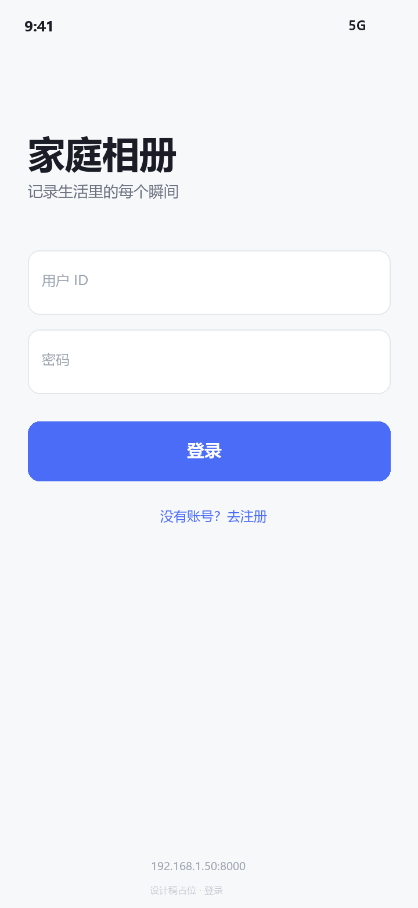
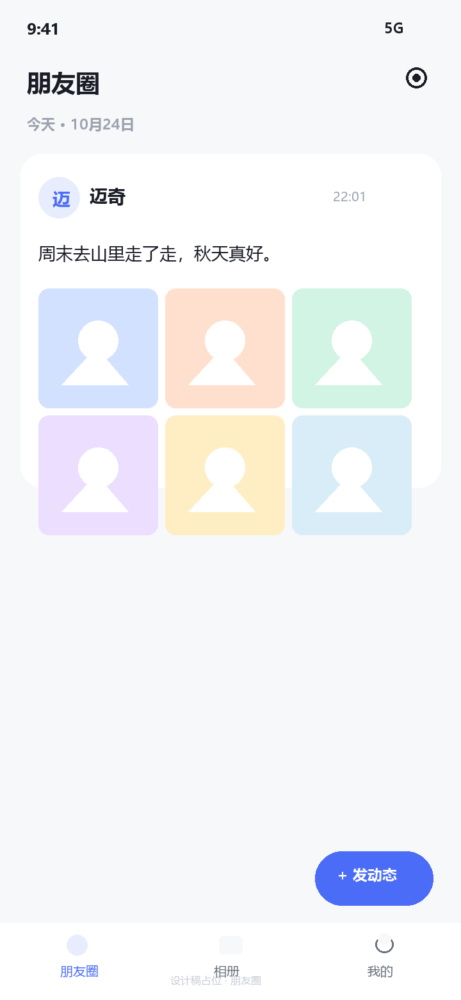
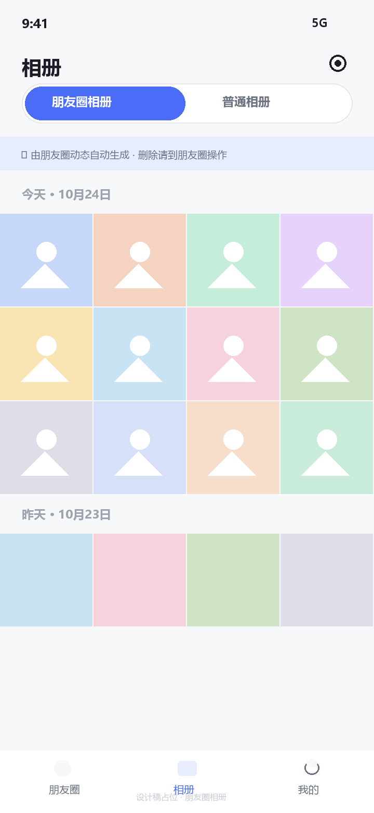
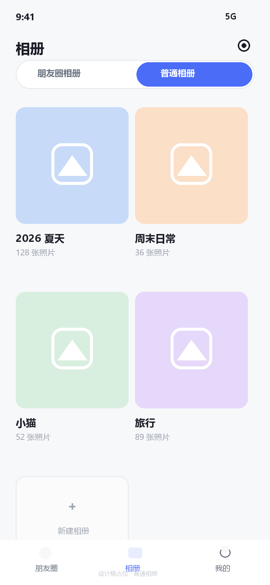
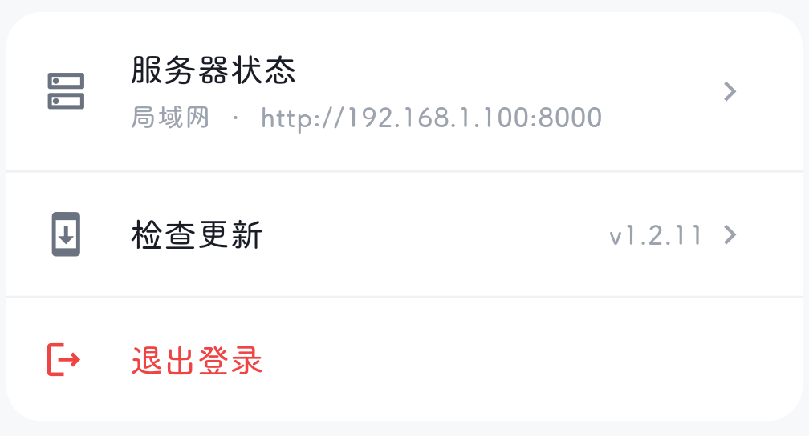
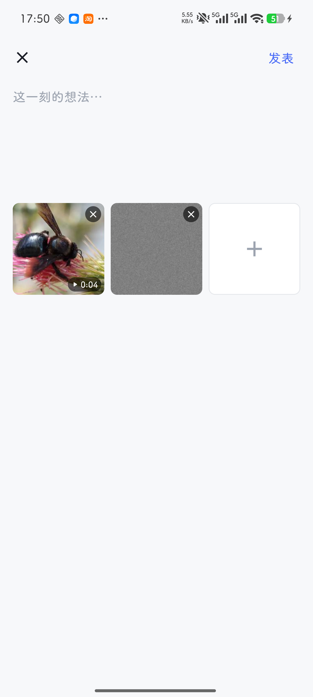
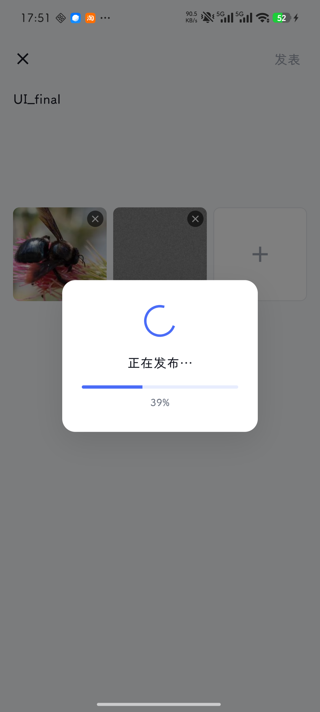
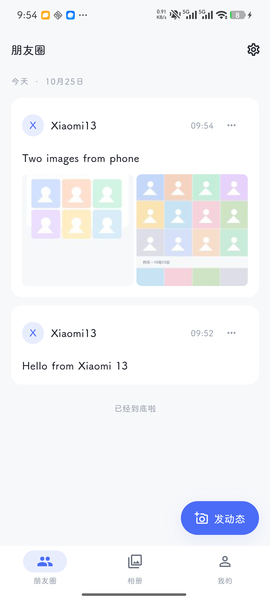
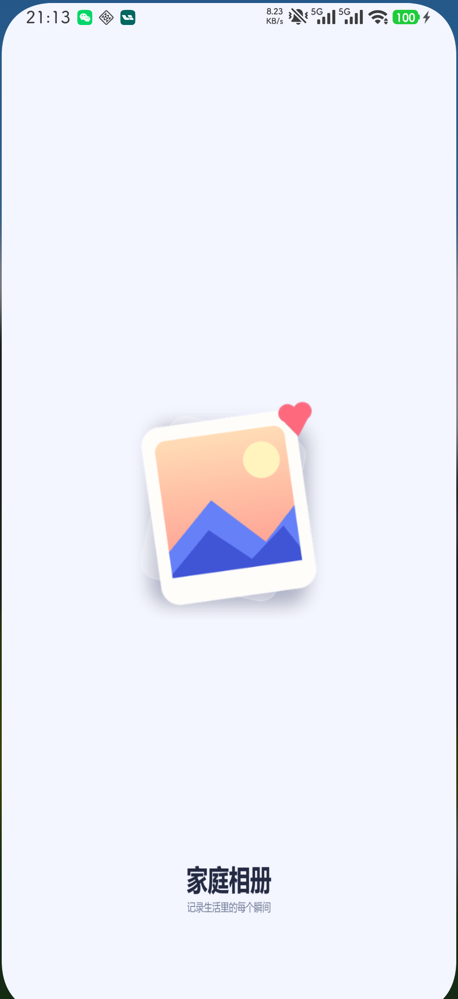

# album-app

局域网家庭相册 Android 客户端。Flutter 3.24+ / Material 3，只生成 Android，
与 `album-server` 通过 HTTP API 通信，两边代码零共享。

设计目标不是「能用的后台工具」，而是像小米相册 × Apple Photos × 小红书那样：
浅灰底、白卡片、低对比、留白、图片主导。

## 界面预览

> 以下为设计稿占位图；用真机截图替换 `screenshots/` 下的同名文件即可。

| 登录 | 朋友圈 | 朋友圈相册 |
|---|---|---|
|  |  |  |

| 普通相册 | 全屏浏览 |
|---|---|
|  |  |

| 我的（手动检查更新） | 发布页 | 发布中 |
|---|---|---|
|  |  |  |

## 功能

- 登录 / 注册 / 登出；服务器地址可在**登录页**和**我的 → 服务器状态**设置
- 图片预览支持下载到系统相册；相册支持多选批量下载；动态照片长按播放
- 朋友圈：按天分组卡片流、九宫格媒体、发布、删除自己的动态、触底加载
- 发布页：无边框输入、3 列媒体网格、图片/视频混合多选、视频首帧缩略图与全屏播放
- 发布页「✨ AI 帮写」：选中媒体后由服务端代理 DeepSeek 视觉模型生成文案建议（不自动发布）
  - 省 token：关闭模型思考（reasoning 0）、提示词精简、图片压到 512px
  - 实测 1 图约 300 token / 3 图约 700 token，单次 2~5 秒
  - 选 4~9 个媒体时均匀取 3 张代表图（首/中/尾），token 与选 3 张时相同
- 发布中点"发表"后全屏遮罩 + 进度百分比，禁止返回、滚动和点击
- 我的页可手动"检查更新"，区分已是最新和网络异常；启动自动检查保留
- 小米动态照片：识别 XMP、左下角"动态"角标，点开/长按自动播放内嵌短片
- 朋友圈相册：只读聚合时间轴、4 列无圆角密铺、日期分组
- 相册页三个 tab：朋友圈相册 / 家庭相册 / 私人相册；点底部「相册」默认家庭相册
- 家庭相册：新建 / 重命名 / 删除、多图/视频上传、长按设为封面或移除，所有人可见
- 上传失败可单条重试或一键全部重试；上传列表支持单条取消 / 取消全部
- 上传期间保持屏幕常亮，锁屏/切网后回到前台自动续传
- 登录页记住最近登录过的账号（下拉切换，也可手动输入），可勾选「记住密码」
- 「我的 → 缓存」显示图片缓存与临时文件占用，可一键清理；图片缓存有 320MB 上限
- 私人相册：新建时可勾选，只有自己可见；可按昵称/用户 ID 分享给家人（对方只读）
- 「我的」可修改昵称，昵称全局唯一（注册时也校验），分享搜人按昵称或登录 ID
- 全屏浏览：PageView 滑动、双指缩放、视频自动播放、Hero、渐变遮罩
- 全屏大图走服务端 `/files/display/<文件名>`：HEIC/超大 JPEG 转成 2560px JPEG 并缓存，
  避免只能显示缩略图
- 同时保存局域网/互联网两个地址，优先局域网，请求失败自动切互联网并重试一次
- 旧版 `server_base_url` 自动迁移为 `lan_url`，升级不需要重新配置
- 401 自动清理登录态；游标分页；上传进度
- 启动时强制更新：检查版本、应用内下载进度、SHA-256 校验、调起系统安装器
- 升级后首次启动展示本次更新日志；首次安装也可作为欢迎页

## 快速开始

要求：Flutter 3.24.5+（Dart 3.5+）、Android SDK（compileSdk 34）、JDK 17。

```bash
cd album-app
flutter pub get
flutter build apk --release
```

APK 输出：`build/app/outputs/flutter-apk/app-release.apk`。调试运行：

```bash
flutter run
```

### 双地址与自动切换

App 默认预置：

```text
局域网  http://192.168.1.100:8000
互联网  http://mikey.fucku.top/album
```

- 登录页右上角设置里可以修改两个地址并测试连通性
- 冷启动会先探测局域网（2 秒超时），失败再探测互联网（5 秒超时）
- 请求遇到连接/超时错误会自动切换地址并重试一次
- 监听 WiFi / 移动网络切换：移动网络自动用互联网；连上 WiFi 先试局域网，失败保持互联网
- 登录页和“我的 → 服务器状态”都可以打开同一个双地址设置对话框
- 旧版本的单地址 `server_base_url` 会在首次启动时迁移为 `lan_url`

如果部署环境不同，改 `lib/core/server_config.dart` 里的
`defaultLanUrl` / `defaultWanUrl` 即可；`API_BASE` 编译参数已不再使用。

### 登录与账号

```text
lib/core/account_store.dart   最近登录过的账号 + 记住的密码（最多 8 个）
lib/core/secure_store.dart    密码加密层：AndroidKeyStore AES/GCM，失败时退回 base64
```

- 登录页默认填入最近登录的账号与密码；用户 ID 右侧箭头打开账号下拉，
  可切换账号、删除记录，或选“使用其他账号”手动输入
- 「记住密码」勾选状态随账号保存；取消勾选后再登录会清掉该账号的旧密码
- 密码用 AndroidKeyStore 里不可导出的密钥加密（`album/secure_store` 通道）；
  密钥失效（重装、换机）时只丢弃密码，账号仍在列表里
- 注册成功后账号也会进入下拉列表，但不会自动保存密码

### 私人相册与账号

```text
albums.visibility    family（默认，所有人可见）/ private（仅创建者与被分享者）
albums.owner_id      创建者；历史相册为 NULL
album_shares         私人相册的分享名单
users.nickname       唯一索引（COLLATE NOCASE），注册/改名都校验
```

- 分享权限：只读（默认，只能看）/ 可写（传、删照片）/ 管理员（还能删相册）；
  创建者始终拥有全部权限，分享名单只有创建者能改
- 分享时按昵称或登录 ID 搜索用户；自己不能分享给自己
- 不可见的相册统一返回 404，避免暴露相册是否存在
- 家庭相册保持原来的行为：所有人可见、都能编辑

## iPad / iOS

采用 **策略 A：全屏竖屏**——`Info.plist` 声明四个方向 + `UIRequiresFullScreen=true`，
`main()` 里 `lockAppPortrait()` 把 UI 锁在竖屏。iPad 的 Split View / Slide Over 因此被禁用，
换来的是横屏时没有黑边、布局与手机一致。

- 方向：`ios/Runner/Info.plist` 的 `UISupportedInterfaceOrientations(~ipad)` 声明四个方向；
  全屏看视频时仍可点右下角旋转按钮临时横屏
- 权限：相册读取/写入、相机、麦克风四项说明（App Store 审核必需）
- 网络：局域网后端是 HTTP，用 `NSAppTransportSecurity` 放行明文；正式上架前建议换成域名白名单
- 平板布局：`lib/core/responsive.dart` 的 `responsiveColumns()`——相册列表 2→3/4 列、
  相册详情与朋友圈相册 4→5/6 列、发布页 3→4/5 列；单条动态九宫格宽度上限 640
- iOS 降级：跳过 APK 更新检查、不提示「删除手机原图」、AI 帮写改用 `dart:ui` 缩图（PNG）

构建（Xcode 只能跑在 macOS 上，Windows/Linux 无法编译 iOS）：

```bash
flutter pub get
(cd ios && pod install)
flutter run -d <ipad>        # 或 flutter build ipa --release
```

### 没有 Mac 的几条路

仓库里已带 `.github/workflows/ios.yml`：推到 GitHub 后，Actions 的 `macos-14`
机器会跑 `flutter build ios --no-codesign`，产出未签名的 `AlbumApp-unsigned.ipa` 工件，
用来验证「iOS 能编译通过」。**未签名的包不能装到真 iPad**。

| 方案 | 能做到 | 成本 |
|---|---|---|
| GitHub Actions（公开仓库） | 编译验证、产出未签名 IPA | 免费 |
| GitHub Actions（私有仓库） | 同上 | macOS 分钟数按 10 倍折算，免费额度很快用完 |
| Codemagic / Bitrise | 签名 + TestFlight 分发，无需本地 Mac | 免费额度有限，超出按月付费 |
| 云端 Mac（MacinCloud / MacStadium） | 完整 Xcode，可连真 iPad 调试 | 按小时/按月租 |
| 借一台 Mac + 免费 Apple ID | 7 天有效的开发签名，装到自己 iPad | 免费，但需每 7 天重签 |

要装到真 iPad 或走 TestFlight，必须有 **Apple Developer Program（99 美元/年）**，
在 CI 里配置证书和描述文件（Codemagic 有向导），或者在借来的 Mac 上用 Xcode 登录 Apple ID
做开发签名。

已知限制：iOS 上「记住密码」走 base64 兜底（Android 用 Keystore）；未配置 fluwx 的 iOS 分享。

### 缓存

```text
lib/core/media_cache.dart    图片磁盘缓存（统一 key、30 天过期、800 个对象）
lib/core/cache_service.dart  统计/清理/启动裁剪
```

- 图片全部走 `flutter_cache_manager` 的 `album_image_cache` 目录
  （`<临时目录>/album_image_cache`），缩略图与全图共用
- 字节预算 320MB：启动时超过就开始按修改时间删最旧的，裁到 240MB 为止
- 临时文件（动图提取、分享、下载、更新包）超过 7 天在启动时清掉
- 「我的 → 缓存」显示「图片 x · 临时 y」，点击弹确认框后清理；
  清理时跳过 `picked_media`（待上传副本）和正在下载的 `album_updates`
- 旧版默认缓存目录 `libCachedImageData` 会在首次启动后清掉

### 上传与失败处理

```text
lib/core/upload_manager.dart   全局上传队列、重试、前后台/网络恢复、持久化续传
lib/core/upload_queue_store.dart 队列写盘（SharedPreferences: upload_queue）
lib/core/picked_media_cleaner.dart 上传成功后清理本地副本
lib/api/album_api.dart         单次上传：源文件校验、卡死检测、自动重试
lib/core/upload_errors.dart    失败分类（取消 / 网络 / 源文件失效 / 服务端拒绝）
lib/widgets/upload_status_overlay.dart  悬浮进度与上传列表
```

- 上传期间用 `wakelock_plus` 保持屏幕常亮，避免自动锁屏把长视频上传掐断
- 锁屏或切到后台导致连接中断时，任务先挂起而不是记失败；回到前台自动续传
- 网络恢复（WiFi/移动数据重新可用）时自动补传网络类失败，最多 2 次
- 单个请求 45 秒没有任何发送进展就中断重试（最多 4 次）；
  字节发完后的“处理中”阶段交给 30 分钟 `receiveTimeout`，不会被误杀
- 上传列表可勾选“仅显示失败”，并直接一键全部重试；不受当前筛选影响
- 本地缓存副本被系统清掉时，条目提示“原文件已失效，请重新上传”，
  只提供“移除”，不会再出现点了没反应的重试按钮
- 每条上传和面板菜单都提供取消：取消会中断请求、移出队列，入口在进度条右侧的 ×
- 上传按 3 路并行：服务端对每个文件要做 hash + ffprobe + ffmpeg 缩略图，
  串行时大量时间在等处理，并行后传下一个与处理上一个重叠（实测约 2~3 倍）
- 队列写进 `SharedPreferences`（`upload_queue`）：App 被杀后重开自动续传，
  登录态确认后才开始
- 上传完成后会询问是否删除手机相册里的原图：只删这一批上传成功、且带相册 URI 的条目，
  Android 11+ 走 `MediaStore.createDeleteRequest` 系统确认弹窗，失败/取消的不动
- 选图副本放在 `filesDir/picked_media`（不是 cache）：系统清理缓存不会删掉
  排队中的文件；上传成功/取消立刻删除，启动时再清掉没有队列引用的残留副本
- 手机存储不足导致复制失败时，选完图会提示“存储空间不足，N 个文件没能读取”
- 重启后如果副本已被系统清理，条目会直接标成“原文件已失效”，不会让队列卡住

下载/相册依赖固定为 `gal: 2.2.3`：gal 2.3.x 的 Android Gradle 脚本使用
`flutter.compileSdkVersion`，与当前 Flutter 3.24 工程不兼容。

构建兼容性：`pubspec.yaml` 显式固定了 `wakelock_plus: 1.2.8`。新版
`wakelock_plus` 会传递依赖 `package_info_plus 9.x`，后者要求比 Flutter 3.24
更新的 Android Gradle 插件接口。`pubspec.lock` 已锁定全部依赖，请一并提交，
不要删除后随意升级。

## 应用内更新与发版

### 1. 在服务器管理后台上传 APK

浏览器打开：

```text
http://<服务器IP>:8000/admin
```

输入后端 `.env` 中的 `UPLOAD_SECRET`，即可拖拽 APK、填写 `versionCode` /
`versionName` / 更新日志并发布。发布后新版本立即成为 App 检查到的当前版本。

### 2. 用发布脚本构建并上传

```bash
cd album-app
export SECRET='你的 UPLOAD_SECRET'
export SERVER='http://<服务器IP>:8000'

./scripts/release.sh 50 1.3.0 "• 修复大视频上传卡顿
• 优化相册加载速度"
```

脚本会：

1. 把更新内容写入 `assets/changelog.md`
2. 以 `versionCode=$1`、`versionName=$2` 构建 release APK
3. 显示 SHA-256
4. 用 `X-Upload-Secret` 调 `/api/app/release` 上传

也可以用后台页面发布，二选一。

> `versionCode` 只增不减。当前服务器已发布 code 70 / v1.2.66，
> 下一次发布请用 `71`；正式服务器从空数据开始，则从 `1` 开始。
>
> **更新判断只看 `versionCode`，不看 `versionName`。** 上传后台时只把版本名
> 改成 1.2.0、versionCode 仍填 2，手机（已装 versionCode 2）不会提示更新；
> 并且后台不会检查 APK 内部实际版本，必须用 `--build-number` 一起构建。
> 上传 `<` 或 `=` 历史最大值的 code 会被后端 400 拒绝。

### 3. 强制更新行为

- App 启动请求 `/api/app/latest`，失败或 404 静默放行，不阻塞登录
- 服务器 `versionCode` 大于本机时弹出不可关闭更新对话框
- 下载在 App 内展示百分比、大小、速度、ETA，完成后校验 SHA-256
- 校验通过后调起 Android 系统安装器；安装完成需用户手动重新打开 App
- 新版本第一次打开展示 `assets/changelog.md`，点“知道了”后记录
  `last_run_version_code`
- 首次安装也会展示一次更新日志（可作为欢迎页）

### 4. 签名（非常重要）

`album-app/android/key.jks` 是当前 release 签名 keystore，
密码、别名在 `album-app/android/key.properties`。这两个文件被 `.gitignore`
忽略，**必须单独备份**，不能丢。新版本 APK 必须用同一个 keystore 签名，
否则 Android 会报：

```text
INSTALL_FAILED_UPDATE_INCOMPATIBLE
```

如果更换 keystore，已安装用户必须卸载重装，后续才可正常升级。

如果 keystore 不在本机，可以通过环境变量构建（CI 可用）：

```bash
export KEYSTORE_PASSWORD='...'
export KEY_PASSWORD='...'
export KEY_ALIAS='album'
# 将 key.jks 放到 android/key.jks
flutter build apk --release --build-number=2 --build-name=1.1.0
```

或创建 `android/key.properties`：

```properties
storePassword=...
keyPassword=...
keyAlias=album
storeFile=../key.jks
```

> 之前用 debug 签名安装过的测试包，首次切换到当前 release 签名时需要先卸载一次。

## USB 真机联调

如果暂时不方便放行 Windows / Linux 防火墙的 8000 端口，可以用 ADB 反向端口：

```bash
# 1. 手机开启 USB 调试并连接电脑
adb devices

# 2. 让手机的 127.0.0.1:8000 指向电脑上的后端
adb reverse tcp:8000 tcp:8000

# 3. 构建/安装后，在登录页设置里填写这个地址
flutter build apk --release
adb install -r build/app/outputs/flutter-apk/app-release.apk
```

小米 / Redmi 的 MIUI、HyperOS 如果报
`INSTALL_FAILED_USER_RESTRICTED: Install canceled by user`，先到开发者选项打开
「USB 安装」；若该开关被隐藏，可把 APK push 到手机
`/sdcard/Download/`，在文件管理器中点开安装（会多一次 ICP / 安全确认）。

## 首次使用

1. 手机与服务器连接同一 Wi-Fi。
2. 打开 App → 登录页右上角设置 → 分别填写局域网/互联网地址 → 测试连接 → 保存。
3. 没有账号？去注册：用户 ID（3~20 位字母数字下划线）、昵称、密码（≥4 位）。
4. 注册成功自动登录，进入「朋友圈」空状态。
5. 点「发动态」，选择文字与图片/视频。
6. 切到「相册 → 朋友圈相册」查看自动聚合的时间轴；切到「普通相册」新建相册并上传。

## 设计规范

### 配色

| Token | 色值 | 用途 |
|---|---|---|
| `primary` | `#4A6CF7` | 主按钮、选中态、链接 |
| `primaryLight` | `#E8EDFE` | 头像底、选中底、提示条 |
| `bgPage` | `#F7F8FA` | 页面底色、日期头 |
| `bgSurface` | `#FFFFFF` | 卡片、输入框 |
| `bgElevated` | `#FBFBFC` | 新建相册卡等浅层 |
| `textPrimary` | `#1A1D26` | 标题、正文 |
| `textSecondary` | `#6B7280` | 辅助文字 |
| `textTertiary` | `#9CA3AF` | 说明、占位、图标 |
| `divider` | `#F0F1F3` | 分割线 |
| `borderLight` | `#E5E7EB` | 输入框 / 卡片描边 |
| `success` | `#10B981` | 连接成功 |
| `warning` | `#F59E0B` | 切换服务器提示 |
| `danger` | `#EF4444` | 删除、错误 |
| `mediaPlaceholder` | `#EFF1F5` | 图片占位块 |

不使用 Material 默认紫，不配置自定义字体（中文包体积考虑）。

### 字体

| Token | 字号 | 字重 | 用途 |
|---|---|---|---|
| `titleLarge` | 22 | 700 | 页面大标题，行高 1.3 |
| `titleMedium` | 17 | 600 | AppBar / 卡片标题 |
| `body` | 15 | 400 | 正文，行高 1.55 |
| `bodySmall` | 13 | 400 | 辅助正文 |
| `caption` | 12 | 400 | 时间、说明 |
| `sectionLabel` | 12 / 600 | 字间距 0.8 | 日期分组、分区标签 |
| `button` | 15 | 600 | 按钮 |

登录页主标题单独 28/800；发布页输入 16。

### 间距与圆角

- 页面左右 16，卡片间距 12，卡片内边距 16，分组间 24
- `xs 4 / sm 8 / md 12 / lg 16 / xl 20 / xxl 24`
- 圆角：`sm 8 / md 12 / lg 16 / xl 20 / pill 999`
- 9 宫格间距 4（朋友圈）、4 列密铺间距 2（相册）、普通相册卡 `childAspectRatio 0.78`

### 阴影与动效

- 卡片默认无阴影，靠白 / 灰底色对比
- FAB 用 `AppShadow.fab`；对话框用 `AppShadow.dialog`
- 图片 fadeIn 200ms，FAB 点击 scale 0.95→1 / 150ms easeOutCubic
- 删除动态列表项 AnimatedSize 250ms；全屏路由 fade + Hero easeInOutCubic
- 禁止弹跳、旋转、炫技动效

### 改主色

只改 `lib/core/design/colors.dart` 两个值：

```dart
static const primary = Color(0xFF4A6CF7);
static const primaryLight = Color(0xFFE8EDFE);
```

`theme.dart` 的 `ColorScheme.fromSeed`、按钮、选中态、进度条全部读取这两个常量。
`primaryLight` 建议改成主色 12%~15% 的浅色，保证白字 / 主色字对比。

## 架构

- 状态管理：`StatefulWidget` + `ValueNotifier`（`CurrentUser`、`AppEvents`），
  **不引入 provider / riverpod / bloc**
- 网络：单例 Dio；`onRequest` 动态读取 `ServerConfig` 作为 baseUrl，
  自动带 Bearer token；`onError` 401 清 token 并回调回登录页
- 存储：SharedPreferences 保存 token、用户 JSON、服务器地址
- 无代码生成：不使用 build_runner / freezed
- 目录：

```
lib/
├── main.dart                 # 启动校验 token、主题、登录态切换
├── core/
│   ├── design/               # colors / text / spacing / radius / shadow / theme
│   ├── api_client.dart       # Dio 单例、鉴权、401、ping
│   ├── auth_storage.dart
│   ├── server_config.dart    # 双地址、探测、自动切换、迁移
│   ├── url_utils.dart        # fullUrl(path)
│   ├── server_settings_dialog.dart
│   ├── current_user.dart
│   ├── app_events.dart       # 删动态后通知朋友圈相册刷新
│   ├── formatters.dart
│   └── media_picker.dart
├── models/                   # app_user / post / media / album / paged / app_release
├── api/                      # auth / post / gallery / album
├── features/
│   ├── auth/                 # login_page / register_page
│   ├── home/                 # 三 Tab + NavigationBar
│   ├── feed/                 # feed_page / post_card / compose_page
│   │   └── preview/          # image_preview_page / video_preview_page
│   ├── album/                # tab / feed_gallery / custom_albums / detail
│   ├── viewer/               # media_viewer_page（图片 + Chewie）
│   ├── update/               # 启动更新 / 下载 / 更新日志 / 版本标记
│   └── profile/              # 我的（版本号 + 手动检查更新）
└── widgets/                  # AppCard / AppButton / AppTextField / AlbumThumb
                               # DateHeader / EmptyState / LoadingView
                               # SectionLabel / PrimaryChip

assets/changelog.md            # 打包进 APK 的本次更新日志
scripts/release.sh             # 构建 + 上传新版本
```

## Android 说明

- 包名 `com.example.album_app`，`minSdk 21`，`targetSdk 34`，`compileSdk 34`
- `AndroidManifest.xml` 已开启 `INTERNET` 与 `android:usesCleartextTraffic="true"`，
  局域网 HTTP 明文访问必需
- 更新安装需要 `REQUEST_INSTALL_PACKAGES` 权限；APK 通过 FileProvider
  `${applicationId}.fileprovider` 交给系统安装器
- release 构建固定使用 `android/key.jks`，不再使用 debug 签名
- `MainActivity` 继承 `FlutterFragmentActivity`，Chewie / video_player 播放器必需
- 启动背景 `#F7F8FA`，避免从启动页进入时白闪
- 未生成 `ios/` 目录，本项目只支持 Android

## 图片格式与动态照片

支持 JPEG、PNG、GIF、WebP、BMP、HEIC/HEIF、AVIF；原图上传不压缩，
不传 `imageQuality`，保留 EXIF/XMP。

动态照片由后端解析并返回 `live_video_url`：

- 网格左上角显示“动态”角标
- 全屏默认显示静态图，点击播放内嵌短片，播放完自动回到静态图
- 后端支持 Google Motion Photo v2/v3 与小米 MicroVideo v1
- HEIC 动态照片当前降级为静态图

## 常见问题

**设置里能填写地址，但保存失败**
先确认服务器 `/health` 可访问，手机与服务器同网段，防火墙放行 8000。

**登录后马上被踢回登录页**
token 过期或后端重启导致会话失效；重新登录即可。

**照片墙空白 / 缩略图加载失败**
检查 `http://<IP>:8000/files/...` 能否在手机浏览器打开；
服务端需要已生成 `data/media/thumbs`。

**视频黑屏或闪退**
确认 `MainActivity` 是 `FlutterFragmentActivity`，App 已重新安装；
服务端 ffmpeg/ffprobe 是否正常。

**Android 9+ 请求被明文策略拦截**
确认 Manifest 的 `usesCleartextTraffic="true"` 未被覆盖。

**模拟器访问不到宿主机**
把局域网地址改成 `http://10.0.2.2:8000`，互联网地址可留空或填同一地址。

## 已知限制

- 无 iOS、无平板专属布局
- 上传不做断点续传：重启后从任务层面续传，单个文件仍从头上传
  （服务端按相册 + hash 幂等，重复上传不会产生重复媒体）
- 视频首帧缩略图由服务端生成；视频过大时上传耗时较长
- 动态照片只在 WiFi/有线时自动播放，移动流量下点一下才播
- 动态视频文件如果丢失，可用 `POST /api/admin/repair/live-videos` 重新提取（需 X-Upload-Secret）
- 仅局域网 HTTP，不建议直接暴露到公网

## License

仅供家庭 / 内部使用。

## 真机实测

小米 13 真机（HyperOS / MIUI V816）安装 release APK 后的朋友圈页面：



已验证：安装启动、注册登录、杀进程重启保持登录、文字动态、多图动态、
朋友圈相册自动聚合、普通相册新建与上传、全屏浏览、删除自己的动态后
朋友圈相册自动移除对应媒体。

更新系统真机实测（v1.0.0 → v1.1.0）：首装欢迎更新日志、强制更新弹窗、
返回键/遮罩不可关闭、App 内下载进度、SHA-256 校验、调起系统安装器、
同签名覆盖升级、升级后更新日志、关闭后不再重复弹出、软回滚不影响高版本。

本轮 UI/UX 真机实测：登录后主页/相册/我的均无服务器设置入口；我的页显示
当前版本并可手动检查更新（提示"已是最新版本"）；发布页无边框输入、纯文字
"发表"、图片+视频混合多选、视频首帧与时长、图片/视频全屏预览、点 X 移除媒体、
有内容关闭时确认、发布遮罩与进度、发布中返回键无效、成功后回列表并刷新；
测试动态已从服务器删除。

2026-10-28 发布 `v1.2.32 (versionCode=36)`：
- 冷启动按 WiFi/移动数据选择局域网或互联网入口
- 互联网探测超时延长到 12 秒

`v1.2.31 (versionCode=35)`：
- 冷启动默认先走互联网入口，避免移动网络先等局域网超时
- 互联网探测超时延长到 12 秒

`v1.2.30 (versionCode=34)`：
- 互联网入口更新为 `https://album.mikeyxu.top:8443`

`v1.2.29 (versionCode=33)`：
- 相册上传从 20 个一组改为逐个文件，失败可继续
- 每个文件 3 次重试、局域网/互联网自动切换重试
- 服务端同相册同 hash 幂等，重试不会产生重复
- nginx 上传/处理超时延长，适配大视频和慢速网络

`v1.2.28 (versionCode=32)`：
- 互联网入口更新为 `https://album.mikeyxu.top`
- 局域网/互联网地址固定只读，移除编辑与保存
- 登录页右上角改为服务器状态图标

`v1.2.27 (versionCode=31)`：
- 普通相册三点菜单新增“清理重复照片和视频”
- 媒体按 SHA-256 去重存储，跨相册/动态共享同一物理文件
- 删除按引用计数判断，最后一个引用才删除文件
- 朋友圈动态删除同步清理无引用媒体

`v1.2.26 (versionCode=30)`：
- 上传字节发完后显示“处理中…”并使用不确定进度，服务端返回后才算完成
- 朋友圈/普通相册上传都采用此状态
- 修复深色主题切换后朋友圈、相册列表部分区域不重建的问题（const 页面/吸顶头重建）

`v1.2.25 (versionCode=29)`：
- “我的”新增主题：浅色/深色/跟随系统，持久化保存
- 全局调色板改为运行时深浅色；登录、相册、朋友圈、表单等同步适配
- 主页面左右滑动切换朋友圈/相册/我的
- 相册左右滑动切换朋友圈相册/普通相册，到边界继续切换主页面

`v1.2.24 (versionCode=28)`：
- 编辑模式顶部仅“已选 N 项”，底部 footer 下载/删除/分享
- 全选所有照片在右上角；日期分组右侧也保留分组全选
- 分享使用系统分享面板，普通相册支持批量移除
- 普通相册列表隐藏配置入口，朋友圈标题居中

`v1.2.23 (versionCode=27)`：
- 编辑模式顶部仅显示“已选 N 项”和全选；不再显示相册切换
- 底部 footer 改为下载/删除/分享三操作，朋友圈无删除
- 编辑时隐藏主屏底部导航，由操作 footer 占位
- 分享使用系统分享面板；普通相册支持批量移除
- 普通相册列表不再显示配置图标；朋友圈标题居中

`v1.2.22 (versionCode=26)`：
- 普通相册列表页也显示配置入口
- 编辑模式支持返回键退出；底部始终显示已选数量
- 日期分组头右侧增加全选；下载按钮改为纯文字
- 相册列表长按增加“修改封面”，进入单选封面选择模式

`v1.2.21 (versionCode=25)`：
- 所有 AppBar 标题居中
- 相册右上角配置菜单：按拍摄/添加时间排序，视图按年/月/日期或连续平铺
- 移除相册多选入口，改为长按缩略图进入批量
- 两个相册视图的“全选/下载”统一下沉到底部操作栏
- 后端 `MediaResponse` 增加 `created_at` 字段供“按添加时间排序”使用

`v1.2.20 (versionCode=24)`：
- 相册页标题改为居中的“朋友圈相册/普通相册”切换，右侧批量选择
- 移除朋友圈相册顶部自动生成提示
- 两个相册视图统一：长按缩略图进入批量，全选/下载放在底部
- 普通相册底部保留“更多”用于封面/移除

`v1.2.19 (versionCode=23)`：
- 修复普通相册批量下载底部操作栏：FilledButton 被全局 `minimumSize: infinity` 撑开，改为固定 44 高紧凑按钮
- 底部安全区和栏高保持正常

`v1.2.18 (versionCode=22)`：
- 朋友圈使用唯一 pinned 日期头，根据视图内第一条动态实时切换
- 日期头不再按分组叠加；动态卡片自己的时间保持不变

`v1.2.17 (versionCode=21)`：
- 朋友圈日期分组头不再 pinned，避免顶部日期叠加
- 顶部不再显示固定日期；只保留视图内动态卡片自己的时间
- 普通相册单次上传上限保持 500

`v1.2.16 (versionCode=20)`：
- 普通相册选择上限从 9 提升到 500
- 相册上传按 20 个一组分批提交，避免 500 项一次 multipart 超过请求体和内存限制
- 上传进度按全部选择项计算

`v1.2.15 (versionCode=19)`：
- 视频头部下载按钮移到左侧，避免和 Chewie 右上角三点设置重叠
- 视频头部新增横屏/竖屏切换按钮（头部隐藏时先点一下屏幕显示）
- 视频预览页也加入旋转按钮

`v1.2.14 (versionCode=18)`：
- 真机已安装 1.2.14；`flutter analyze` 无问题，测试 19 项通过
- 视频比例按 `VideoPlayerValue.rotationCorrection` 修正；动态照片同一比例
- 动态照片播放完成后暂停、归零并恢复静态图
- 修正带 90/270 度旋转元数据的视频比例：播放器宽高比按 rotationCorrection 交换
- 动态照片播放使用同样修正后的比例；播放完成暂停、回到 0 并恢复静态图
- 视频页仍默认隐藏头部，手动转动手机横屏，不按视频比例强制转屏

`v1.2.13 (versionCode=17)`：
- 视频页使用 FULL_SENSOR 方向：不再按视频比例自动转屏，手动转动手机即可横屏
- 视频播放默认隐藏 App 顶部（日期/关闭/计数/下载），点击屏幕显示或隐藏
- 普通相册上传与朋友圈共用 `pickMultipleMediaFiles()`：图片/视频混选、动态照片原图上传
- 不传 `imageQuality`，避免 Motion Photo 的 XMP 被重编码丢弃

`v1.2.12 (versionCode=16)`：
- 视频全屏不再按视频比例自动转屏，保持竖屏并适配视频尺寸；视频页允许手动横屏
- 视频播放默认隐藏顶部信息（日期/关闭/计数/下载），点击屏幕显示或隐藏
- 普通相册上传改为与朋友圈一致的 `pickMultipleMedia` 系统混合选择器
- 不传 `imageQuality`，保留原图和 Motion Photo 的 XMP，支持一次选择图片、视频和动态照片

`v1.2.11 (versionCode=15)`：
- 全新品牌 App 图标：渐变相册卡片 + 夕阳 + 爱心，包含自适应图标和圆形图标
- Android 12 启动屏改为浅蓝底 + 透明照片卡片 + “家庭相册”品牌字
- Flutter 启动页/登录页加入品牌图标、柔和光晕和渐入动画
- 修正登录页品牌图标被拉伸的问题




`v1.2.8 (versionCode=12)`：
- 图片预览右上角新增“保存到相册”按钮
- 朋友圈相册和普通相册支持“选择 → 全选/多选 → 下载”
- 动态照片长按缩略图会打开预览并播放内嵌短片，预览页长按会从头重播

批量下载实测：在朋友圈相册选择 2 张，进度框完成后提示“已保存 2 项到相册”；
文件落在系统相册 `Pictures/家庭相册/`，测试后已清理。
单张下载实测：预览页点击右上角下载按钮，提示“图片已保存到相册”。

`v1.2.6 (versionCode=10)`：
监听 WiFi / 移动网络切换；切到移动网络自动使用互联网，连回 WiFi 先探测
局域网，局域网可达就切回，不可达保持互联网；App 回前台会补检一次网络变化。

“我的”页显示当前服务器状态，点击打开与登录页相同的双地址设置对话框；
页面底部无关文字已移除。

网络架构升级（1.2.4 起）：同一后端同时支持局域网根路径和 nginx `/album`
前缀；App 保存双地址并优先局域网、请求失败自动切互联网并重试一次；旧版单
地址自动迁移；登录页/我的页可分别测试两路地址；管理后台按当前 URL 计算
API 前缀。

已完成的验证：

- 真机 WiFi 关闭（5G）冷启动：自动使用互联网地址，朋友圈正常加载，
  “我的”显示“互联网 · http://mikey.fucku.top/album”
- 真机恢复家庭 WiFi 冷启动：自动使用局域网地址，显示“局域网 · http://192.168.1.100:8000”
- 真机运行中关闭 WiFi：App 进程不重启，5G 下继续使用；恢复 WiFi 后服务器状态回到局域网
- 设置对话框从“我的 → 服务器状态”打开，测试结果为局域网 22ms、互联网 1630ms
- `ServerConfig` 默认值、路径保留、旧 `server_base_url` 迁移单元测试
- `ApiClient` 在 `http://host/album` base 下拼出 `/album/api/...` 且保留 query 参数
- 后端 `CONTEXT_PATH=/album` 时 `/album/health`、`/album/api/...`、
  `/album/admin/index.html` 正常，根路径 404；不设时行为与原来一致
- Release 1.2.4 通过 App 内更新安装成功

Motion Photo 的内嵌 MP4 由客户端按 XMP 的 `Item:Length` 从原图尾部提取，
本地文件直接读尾部，服务器图片按 HTTP Range 只下载尾部，不需要后端改表。
